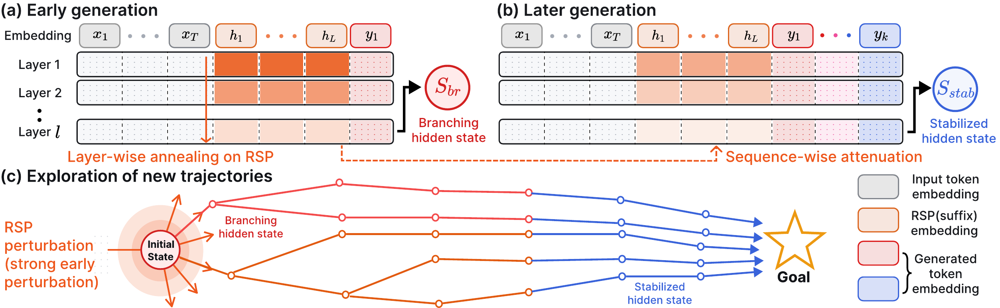

# From Noise to Diversity: Random Embedding Injection in LLM Reasoning

[](https://arxiv.org/abs/2605.11936)
[](LICENSE)

Official implementation of **Random Soft Prompts (RSP)**.
An RSP is a sequence of `L` random vectors drawn from a Gaussian fitted to the model's
embedding table and appended to the input. It needs no training, perturbs the first few
decoding steps, and widens Pass@N under independent resampling while greedy accuracy stays
in the range of trained soft prompts.

<p align="center">
  
</p>

## Installation

```bash
conda create -n RSP python=3.11 -y
conda activate RSP
pip install -r requirements.txt
pip install flash-attn==2.8.3 --no-build-isolation   # optional, speeds up SFT
python scripts/download_data.py                       # MATH-500, GSM8K, AIME24 -> eval/data/
```

## Quick Start

Evaluate Qwen2.5-Math-1.5B-Instruct on MATH-500 with a 20-token suffix RSP:

```bash
python eval.py \
    --model_name_or_path Qwen/Qwen2.5-Math-1.5B-Instruct \
    --data_names math500 \
    --embedding_mode suffix --num_embedding_tokens 20 --embedding_seed 15 \
    --batch_size 32 --output_dir output/rsp_suffix
```

Set `--embedding_mode none` for the baseline, or `prefix` to prepend the RSP instead.
Results are written to `output/rsp_suffix/math500/` as a `.jsonl` with per-problem
generations and a `*_metrics.json` with accuracy.

For LLaMA-3.1-8B-Instruct use `--prompt_type mathstral --apply_chat_template`;
for Qwen base models without a chat template use `--prompt_type mathstral`.
Run `python eval.py -h` for all options.

## Reproducing the Paper

### Accuracy tables and Pass@N

```bash
# Table 2 (full version: Table 10): greedy accuracy over 5 RSP seeds for all models and benchmarks
bash scripts/main_tables.sh
python scripts/aggregate.py output/main_tables

# Figure 4: Pass@N with 16 samples per problem
bash scripts/pass_at_n.sh
python scripts/pass_at_n.py output/pass_at_n/math500 --plot pass_at_n_math500.pdf
```

Both scripts take env overrides to run a subset, e.g.
`CONFIGS="qwen25_math_1.5b_inst" SEEDS="15" bash scripts/main_tables.sh`.
Runs resume from existing outputs.

### Rejection-sampling SFT

RSP is used only to collect training data: for each hard problem we sample 8 rollouts
(each with its own RSP), keep the correct ones, fine-tune Qwen2.5-Math-7B-Instruct on
them, and evaluate without RSP.

```bash
python sft/prepare_data.py            # OpenR1-Math-46k problems
python sft/download_eval_data.py      # Minerva, GaoKao2023-EN, OlympiadBench, AIME24, AMC23

bash sft/run_sft.sh rsp 42            # collect with RSP -> SFT -> evaluate
bash sft/run_sft.sh baseline 42       # same without RSP
```

The fixed hard subset used in the paper (32,737 problems the model solves at most once in
4 clean rollouts) ships in `sft/data/`. To rebuild it, or to build one for another model:

```bash
python sft/collect_rollout.py extract --model Qwen/Qwen2.5-Math-7B-Instruct \
    --problems sft/data/openr1_math_46k.parquet --output_dir output/hard --n 4
```

Rollouts are graded with [mathruler](https://pypi.org/project/mathruler/) (boxed answer vs.
ground truth). The paper reports the mean over collection seeds 42, 43 and 44. Collection
runs one vLLM process per GPU; SFT uses FSDP on the same GPUs (8 x H100 in the paper).

## Citation

```bibtex
@inproceedings{kim2026rsp,
  title     = {From Noise to Diversity: Random Embedding Injection in LLM Reasoning},
  author    = {Kim, Heejun and Lee, Seungpil and Yeom, Jewon and Sok, Jaewon and
               Park, Seonghyeon and Park, Jeongjae and Kim, Taesup and Kim, Sundong},
  booktitle = {Advances in Neural Information Processing Systems},
  year      = {2026},
  url       = {https://arxiv.org/abs/2605.11936}
}
```
